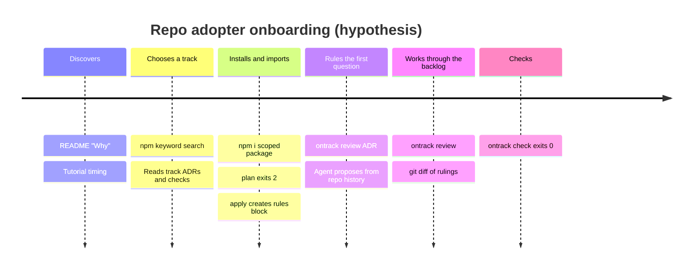
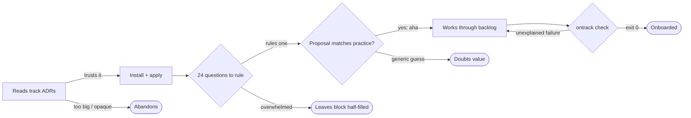

# Customer Journey Map: Repo adopter - from discovering ontrack to a first green `ontrack check`

> **Hypothesis mode.** No interview, survey or analytics data backs this map.
> Every emotion, pain point and moment of truth is a hypothesis (Confidence:
> Low). Where a row cites a "product signal", it points to something
> observable in the product or its docs (a README warning, a CLI output, a
> fixed bug). A product signal shows the friction can happen. It does not
> show how often adopters hit it or how they feel about it. See
> [Research gaps](#research-gaps).

## Executive Summary

A tech lead adopts ontrack on an existing repository to stop shared
conventions from drifting between repositories. The mechanics are fast: the
tutorial imports a track in 14 seconds. The long part comes after the import,
when the repository has about two dozen proposed questions to rule before
`AGENTS.md` holds real rules and `ontrack check` means anything. The
hypothesised moment of truth is **the first ruling**. The agent proposes an
answer drawn from the repository's own history, and the adopter either sees
their existing practice written down or sees a generic guess. The biggest
risks are the size of the post-import backlog and the trust decision about
installing a third-party track. Opportunities cluster on ordering and batching
that backlog, and on making the first green check reachable before every
question is answered.

## Persona / Segment

**Repo adopter.** A tech lead or senior engineer who owns one or more existing
repositories (Node project with a `package.json`, a git history, CI on a
forge). They work with a command-line coding agent (Claude Code) and already
have an `AGENTS.md` or are about to write one. They maintain conventions
(commits, branching, tests, delivery) by copying them between repositories and
watching them drift. They are comfortable with npm aliases and exit codes. They
judge dependencies before installing them. No `foundation-persona` artifact
exists yet. This summary is itself a hypothesis.

## Journey Scope

- **Journey type:** Linear
- **Included:** First contact with ontrack → choosing a track → install →
  `plan` / `apply` → ruling proposed ADRs with a coding agent → first
  `ontrack check` that exits `0`.
- **Excluded:** Writing a track; later track upgrades and revised questions;
  superseding an accepted ADR; wiring `plan` into CI (it is the natural next
  journey); team rollout across many repositories.

## Stages

| # | Stage | Customer goal | Duration | Entry trigger | Exit criterion |
|---|---|---|---|---|---|
| 1 | Discovers | Find out whether a tool keeps shared conventions from drifting | Minutes | Notices drift between repositories, or an `AGENTS.md` that no longer matches practice | Opens the tutorial or the README install section |
| 2 | Chooses a track | Pick a set of ADRs worth importing and trust it | 10–60 min | Learns a track is an npm dependency | Decides on a track (public one, or "I'll write my own") |
| 3 | Installs and imports | Get the ADRs into the repository without breaking anything | Minutes | Runs `npm i -D @trivoallan/ontrack` | `ontrack apply` prints `AGENTS.md: rules block created` |
| 4 | Rules the first question | See ontrack turn the repository's practice into a rule | ~1–5 min | Follows the `next:` hint and runs `claude "$(npx ontrack review)"` | One ADR moves from "Not yet decided" to a rule in `AGENTS.md` |
| 5 | Works through the backlog | Answer the remaining proposed ADRs | Hours to days, spread over sessions | The rules block still lists ~24 undecided questions | Every ADR is accepted, rejected or left on purpose |
| 6 | Checks | Prove the repository meets the rules it decided | Minutes per failure | Runs `npx ontrack check` | `check` exits `0` |

## Touchpoints per Stage

| Stage | Touchpoint | Channel | What happens |
|---|---|---|---|
| Discovers | README "Why" | GitHub | Reads the drift problem and the three promises (import, `plan` exit code, `AGENTS.md`) |
| Discovers | Docs site home + tutorial | Starlight site | Sees "Try ontrack on one repository" and its 14-second timing |
| Chooses a track | Find a track | Docs | Searches npm for `keywords:ontrack-tracks` |
| Chooses a track | Track README and ADRs | GitHub / npm | Counts questions, spots ADRs with a `check` key that will run commands locally |
| Installs and imports | `npm i -D @trivoallan/ontrack` | Terminal | Installs the scoped package; the unscoped `ontrack` on npm is another project |
| Installs and imports | `npm i -D <alias>@npm:<track>` | Terminal | Learns npm's alias syntax; the alias becomes the namespace |
| Installs and imports | `ontrack plan` | Terminal | Sees `25 new`; exits `2` |
| Installs and imports | `ontrack apply` | Terminal | ADRs land in `docs/adr/<alias>/`; rules block created; `next: 24 proposed ADRs to rule` |
| Rules the first question | `ontrack review ADR-xxxx` | Terminal → coding agent | Agent reads the ADR, searches the repository, proposes a status and values, waits |
| Rules the first question | `AGENTS.md` rules block | Editor / git diff | The answered ADR becomes a YAML rule |
| Works through the backlog | `ontrack review` (no argument) | Coding agent | Agent works through the remaining proposed ADRs, one agreement at a time |
| Works through the backlog | `git status` / diff | Terminal | Adopter reviews everything ontrack and the agent changed; ontrack never commits |
| Checks | `ontrack check` | Terminal | Runs each decided ADR's check command; exits `2` on a failure |

## Emotional Curve

All rows are hypotheses.

| Stage | Dominant emotion | Confidence | Source |
|---|---|---|---|
| Discovers | Recognition ("that's my drift problem") mixed with skepticism about another governance tool | Low | Hypothesis |
| Chooses a track | Wariness: a track is a dependency whose checks run commands on my machine | Low | Hypothesis; product signal: "Find a track" warns that ontrack does not review tracks |
| Installs and imports | Brief confusion over package naming, then relief at the speed | Low | Hypothesis; product signal: README warns about the unscoped `ontrack`; a CLI fix (#202) now prints the scoped form |
| Installs and imports (after `apply`) | Deflation or overwhelm at "24 proposed ADRs to rule" | Low | Hypothesis; product signal: tutorial output |
| Rules the first question | Delight if the agent finds the existing practice; disappointment if it guesses generically | Low | Hypothesis; product signal: on an empty repository the tutorial's agent proposed `scopes: []`, `tool: none` |
| Works through the backlog | Fatigue; temptation to accept proposals without reading them | Low | Hypothesis |
| Checks | Satisfaction if it passes; irritation if a failure points at a convention nobody chose consciously | Low | Hypothesis |

## Pain Points and Moments of Truth

| Stage | Pain / Moment of Truth | Severity (1-5) | Customer evidence | Implication |
|---|---|---|---|---|
| Chooses a track | **MoT: "Do I trust this track?"** The adopter must import every question of a track and accept that `check` keys run commands | Moment of Truth (4) | Hypothesis; product signal: "A repository installs a whole track" | A track that looks too large or too opinionated ends the journey before install |
| Installs and imports | Package name collision: `npx ontrack` without the scoped install runs another project | 3 | Hypothesis; product signal: README warning, fix #202 | Early error that makes the product look broken; mostly mitigated |
| Installs and imports | npm 12 refuses git dependencies without `allow-git=root` | 2 | Hypothesis; product signal: README note | Hits only adopters who install from git |
| Installs and imports | **MoT: the backlog reveal.** `apply` ends with ~24 questions to rule | Moment of Truth (5) | Hypothesis; product signal: tutorial output | Decides whether ontrack reads as "done in 14 seconds" or "a week of homework" |
| Rules the first question | **MoT: the first proposal.** The agent's answer matches the repository's practice, or it does not | Moment of Truth (5) | Hypothesis; product signal: tutorial notes the empty-repository result | This is the "aha": ontrack writes down what the team already does |
| Works through the backlog | No order or grouping across questions; each ruling needs an agreement | 4 | Hypothesis | Risk of abandoning midway with a half-filled "Not yet decided" list |
| Works through the backlog | Rubber-stamping agent proposals to get through | 3 | Hypothesis | Rules in `AGENTS.md` the team never really decided, which undermines the core promise |
| Checks | **MoT: first `check` run.** A failure on a convention the adopter barely looked at | Moment of Truth (4) | Hypothesis | A green check is the proof of value; a confusing red one reads as noise |

## Opportunities

<!-- incongru-voix: debord — "7 of 24 ruled" measures progress through the image of governance — separates the adopter finishing a counter from the developers inheriting unchosen rules; see .nanopm/wiki/research/problem-statement-backlog-reveal.md, "Why ruling count is not the primary metric" -->

| Stage | Opportunity | Product change that addresses it | Effort (rough) |
|---|---|---|---|
| Chooses a track | Make the trust decision cheaper | A track summary (question count, subjects, which ADRs carry `check` and what they run) shown before or by `plan` | Medium |
| Installs and imports | Finish closing the naming trap | Keep printing the scoped form; consider an explicit hint when the unscoped package is detected | Small |
| Installs and imports | Reframe the backlog reveal | `apply` states that the repository is usable now and that questions can be ruled over time; suggest a first handful instead of "24 to rule" | Small |
| Rules the first question | Steer the first ruling toward a guaranteed hit | Have the `next:` hint point at a question the repository's history answers well (e.g. commits), not the first in order | Medium |
| Works through the backlog | Make the backlog tractable (only alongside the evidence guard below: a progress counter on its own rewards rubber-stamping) | Group or order questions by theme or by evidence strength; let `review` take a batch and show progress ("7 of 24 ruled") | Medium |
| Works through the backlog | Guard against rubber-stamping | The review prompt shows the evidence behind each proposal so the adopter agrees to something they can see | Small |
| Checks | Get to a first green check early | Let `check` run on the ADRs decided so far and say how many are still undecided; explain each failure with the rule it enforces | Small–Medium |

## Visual

### Master diagram

### Sectional diagram: the decision points

## Research Gaps

| Gap | Why it matters | Cheapest research to close it |
|---|---|---|
| Whether adopters exist beyond the maintainer, and who they are | The persona itself is unvalidated | 5 short interviews with people who installed `@trivoallan/ontrack` (npm download data narrows who to ask) |
| Where adopters stop (after install? mid-backlog?) | Decides which moment of truth to fix first | Observe 3 first-time adopters running the tutorial on their own repository, thinking aloud |
| Whether the backlog reveal causes abandonment | Severity 5 is a guess | In the same sessions, note reaction at the `apply` output; count ADRs ruled in the first session |
| How often the first proposal matches existing practice | It is the hypothesised aha moment | Run `review` on 5 real repositories with history; score match rate per ADR |
| Trust criteria for a third-party track | Gates the whole journey | Ask interviewees what they check before installing a track; compare with what "Find a track" tells them |
| Emotional data for every stage | Every row above is Confidence: Low | Post-onboarding survey (3–5 questions) once there are enough adopters |

**Next step:** take the two severity-5 moments of truth (the backlog reveal
and the first proposal) into `define-problem-statement` once the observation
sessions confirm or refute them.
