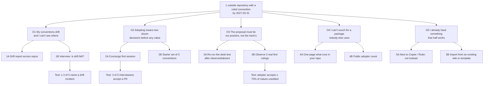

# Opportunity Solution Tree: a first ruled convention outside our repositories

## Desired Outcome

**Outcome Statement:** one public repository, outside the maintainer's
accounts and organisations, holds an ontrack instructions block in
`AGENTS.md` with at least one ruled convention.
**Current State:** 0 (GitHub code search, 2026-11-21). The 969 monthly
downloads are the maintainer's own CI and are not a baseline.
**Target State:** 1 by 2027-03-31; 3 by 2027-06-30.
**Timeframe:** leading step by 2027-01-31 (five interviews), outcome by
2027-03-31.
**Owner:** Tristan Rivoallan

### Why This Outcome Matters

Every track decision so far rests on one user. One outside repository that
rules on a convention turns the journey map, the problem statement and the
competitive white space from guesses into things that can be watched. The
outcome counts a ruling, not an install: an install with nothing ruled
says nothing about whether ontrack does its job. ADR-0029 says how it is
counted.

---

## Visual Tree

---

## Opportunity Branches

### Opportunity 1: "My conventions drift between repositories, and I can't see where"

**Description:** the tech lead knows the repositories differ but finds out
only when a review or an agent trips on it.
**Impact Potential:** High: it is the problem ontrack claims to solve.
**Confidence:** Low.

**Evidence:**
- `docs/why-ontrack.md`: the problem as the maintainer states it (no
  adopter source).
- Competitive analysis: five tool families address it, which suggests the
  pain is real for someone. It does not show it is real for this segment.

#### Solutions

**Solution 1A: Drift report across repositories**
- Description: `plan` run over several repositories, listing which
  conventions each one ruled differently.
- Effort: M
- Riskiest Assumption: tech leads want to see drift before they fix it.
- Assumption Test: show a hand-made report for their own repositories in
  the interview and ask what they would do with it.

**Solution 1B: Ask first**
- Description: build nothing; ask the five interviewees for the last time
  drift cost them something.
- Effort: S
- Riskiest Assumption: they remember an incident.
- Assumption Test: ≥ 3 of 5 describe a specific incident in the past six
  months.

---

### Opportunity 2: "Adopting means two dozen decisions before any value"

**Description:** after `apply`, about 25 conventions wait to be ruled.
**Impact Potential:** High: the journey map puts the moment of truth here.
**Confidence:** Medium: the product signal is observed (`apply` output);
the reaction is not.

**Evidence:**
- `.nanopm/wiki/research/problem-statement-backlog-reveal.md` (hypothesis).
- `apply` prints "next: 24 proposed ADRs to rule" (observed product signal).
- Phase 1 of `.nanopm/wiki/research/prd-backlog-reveal.md` shipped; phase 2 waits on
  observation.

#### Solutions

**Solution 2A: Concierge first session**
- Description: the maintainer runs the import and the review in an
  interviewee's repository and opens a pull request with the proposed
  rulings, marked observed or absent, for them to accept, edit or close.
- Effort: S per repository
- Riskiest Assumption: someone lets an outsider open such a pull request.
- Assumption Test: offer it at the end of each interview; ≥ 3 of 5 accept.

**Solution 2B: A starter set**
- Description: a track can mark five conventions to rule first; the rest
  stay proposed without blocking anything.
- Effort: M
- Riskiest Assumption: the same five matter to most repositories.
- Assumption Test: in the concierge sessions, note which conventions each
  adopter rules first.

---

### Opportunity 3: "The proposal must be our practice, not the track's"

**Description:** an adopter trusts the tool if the first proposal writes
down what the team already does.
**Impact Potential:** High: no competitor drafts a ruling at all.
**Confidence:** Medium: the agent side is measured; the adopter side is not.

**Evidence:**
- Desk test v1: 45% of departing values matched (validated, invalidated H1).
- Desk test v2: 60% after step 2 was reworded (validated, inconclusive).
- `observed`/`absent` marks shipped after v2 and were never measured.

#### Solutions

**Solution 3A: Re-run the desk test**
- Description: same 10 repositories, answer key and harness, prompt as
  shipped today.
- Effort: S ($20, about an hour)
- Riskiest Assumption: marking a value `absent` counts as a match when the
  adopter reads it.
- Assumption Test: score both readings; ≥ 70% under the "absent is
  labelled" reading.

**Solution 3B: Observe real first rulings**
- Description: during the concierge sessions, count values the adopter
  accepts unedited.
- Effort: S, inside 2A
- Riskiest Assumption: what an adopter accepts is what they do.
- Assumption Test: ≥ 70% accepted unedited across three repositories.

---

### Opportunity 4: "I can't vouch for a package nobody else uses"

**Description:** a tech lead has to defend the install to the team and to
security review.
**Impact Potential:** Medium.
**Confidence:** Low.

**Evidence:**
- Journey map: the trust decision on a third-party track (hypothesis).
- Zero external adopters (observed).

#### Solutions

**Solution 4A: "What runs in your repository" page**
- Description: one page listing every file written, command run and
  workflow called, and how to remove it all.
- Effort: S
- Riskiest Assumption: the blocker is information, not the solo maintainer.
- Assumption Test: ask interviewees what they would need to approve it.

**Solution 4B: Public adopter count**
- Description: publish the count of ADR-0029 monthly.
- Effort: S
- Riskiest Assumption: a small honest number helps more than none.
- Assumption Test: none before there is a number above zero.

---

### Opportunity 5: "I already have something that half works"

**Description:** the team has a template, a shared config or a wiki; ontrack
is one more tool.
**Impact Potential:** Medium.
**Confidence:** Low.

**Evidence:**
- Competitive analysis: Copier, shared configs, Ruler/rulesync are free and
  known.

#### Solutions

**Solution 5A: Position next to, not against**
- Description: docs that show ontrack with Copier and Ruler in the same
  repository.
- Effort: S
- Riskiest Assumption: they will keep both.
- Assumption Test: ask interviewees which tool they would remove.

**Solution 5B: Import from what exists**
- Description: draft a track from an existing wiki page or template.
- Effort: L
- Riskiest Assumption: their conventions are written well enough to import.
- Assumption Test: ask for the page in the interview and try it by hand.

---

## Prioritization

### Current Focus

**Priority Opportunity:** O2 + O3 together, through the concierge session.
**Priority Solution:** 1B (interviews) as the gate, then 2A (concierge pull
request) with 3B measured inside it. 3A runs now in parallel because it is
cheap and needs nobody.
**Rationale:** the outcome needs one outside repository, and the concierge
session is the shortest path to one that also observes O2 and O3. Every
solution that builds features (1A, 2B, 5B) waits until an adopter has been
watched.

### Opportunity Ranking

| Rank | Opportunity | Impact | Confidence | Effort | Score |
|------|-------------|--------|------------|--------|-------|
| 1 | O3 Our practice, not the track's | H | M | L | Only measured evidence; 3A runs now |
| 2 | O2 Two dozen decisions | H | M | L | Tested by the same session as O3 (2A) |
| 3 | O1 Drift is felt | H | L | L | Costs one question per interview |
| 4 | O4 Vouching | M | L | L | One page |
| 5 | O5 Already have something | M | L | M | Costs one question per interview |

### Parking Lot

- Support for more coding agents: no adopter has asked; Claude Code is the
  only host (engineering/ADR-0017).
- A third track: two tracks and no outside user.
- Launch posts: downloads do not tell why someone stopped.

---

## Experiments Backlog

| Solution | Assumption | Test Method | Success Criteria | Status |
|----------|------------|-------------|------------------|--------|
| 1B | Drift is felt | 5 interviews | ≥ 3 of 5 name a recent incident | Planned |
| 2A | An outsider's PR is welcome | Offer at the end of each interview | ≥ 3 of 5 accept | Planned |
| 3A | observed/absent raises the match | Desk test v3 | ≥ 70% of departing values | Planned |
| 3B | Proposals match practice in real use | Count unedited values in concierge PRs | ≥ 70% over 3 repositories | Planned |

---

## Learning Log

| Date | Experiment | Result | Learning | Impact on Tree |
|------|------------|--------|----------|----------------|
| 2026-11-15 | Desk test v1 | Fail (45%) | The agent kept the recommendation where the practice was an absence | O3 created |
| 2026-11-15 | Desk test v2 | Inconclusive (60%) | The agent sees the absence, then proposes the recommendation anyway | observed/absent marks shipped; 3A added |

---

## Next Steps

- [ ] Book five interviews (maintainer, by 2027-01-31).
- [ ] Run desk test v3 with the shipped prompt (maintainer or agent, before the interviews).
- [ ] Rule on ADR-0029 so the outcome has a count.
