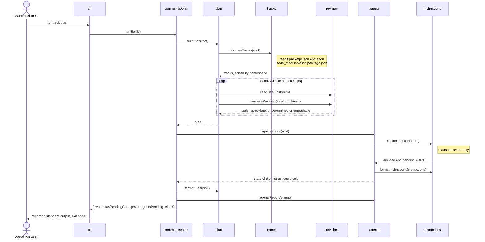

# Runtime View

Every command runs the same way: `bin/ontrack.ts` calls `main` in
`src/cli.ts`, which parses the arguments, calls the handler of the selected
subcommand with the options and an `Io`, and returns the handler's exit
code. An error thrown anywhere below is caught in `main`, printed on
standard error, and becomes exit code `1`.

The two scenarios below are the ones that involve several modules. The
other commands are one call each: `instructions` calls `buildInstructions`,
`review` calls `selectAdr` or `pendingAdrs`, and `check` calls `runChecks`.
What each command must print and return is in its specification, linked
from [Introduction and Goals](01-introduction-and-goals.md).

## `ontrack plan`

`plan` reads and never writes. It builds the plan of every track, asks for
the state of the instructions block, prints both and returns `2` when either needs
attention.



## `ontrack apply`

`apply` builds the same plan, derives the actions and checks all of them
before the first write. With `--dry-run` it stops before writing and
computes what would remain. Otherwise it executes the actions, writes the
instructions block, and builds the plan again to report what still needs a person.

```mermaid
sequenceDiagram
    actor User as Maintainer
    participant Cli as cli
    participant Cmd as commands/apply
    participant Plan as plan
    participant Apply as apply
    participant Links as links
    participant Agents as agents

    User->>Cli: ontrack apply
    Cli->>Cmd: handler(io, prune, confirm, dryRun)
    Cmd->>Plan: buildPlan(root)
    Plan-->>Cmd: plan
    Cmd->>Apply: planActions(root, plan, prune, confirm)
    Note right of Apply: throws before any write on a<br/>name it cannot confirm or a taken target
    Apply-->>Cmd: actions (imported, moved, confirmed, pruned)
    opt at least one file moves
        Cmd->>Links: findLinks(root, moves)
        Links-->>Cmd: links the moves break
    end
    alt dry run
        Cmd->>Agents: agentsStatus(root)
        Agents-->>Cmd: state of the instructions block
        Cmd->>Apply: planAfter(plan, actions)
        Apply-->>Cmd: remaining plan
    else
        Cmd->>Apply: runActions(root, actions)
        Note right of Apply: copies, moves (git mv or rename),<br/>sets revision, deletes under docs/adr/
        Cmd->>Agents: agentsStatus(root)
        Agents-->>Cmd: state of the instructions block
        opt block missing or out of date
            Cmd->>Agents: writeAgents(status)
        end
        Cmd->>Plan: buildPlan(root)
        Plan-->>Cmd: remaining plan
    end
    Cmd->>Apply: formatApply(actions, links, agents, remaining)
    Cmd-->>Cli: 2 when something remains, else 0
    Cli-->>User: report on standard output, exit code
```

When there is no action and the instructions block needs no write, the handler
skips `formatApply`, prints the plan with `formatPlan` and returns what
`plan` would. The instructions block is computed after `runActions`, on the
resulting tree, so an ADR imported in the same run is already listed in it.
