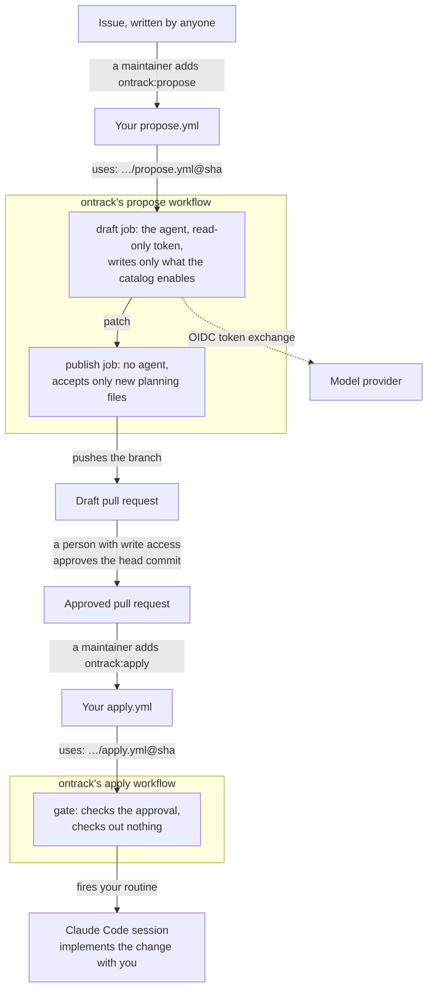

This guide sets up, in your own repository, the two labels ontrack uses on
itself:

- `ontrack:propose` on an issue: a coding agent drafts a change proposal from
  the issue and opens it as a draft pull request.
- `ontrack:apply` on that pull request, once a person with write access has
  approved its last commit: a Claude Code session starts and implements the
  change with you.

Both are reusable workflows that live in ontrack. Your repository calls them
by commit SHA, and does not copy them. The security posture stays in ontrack:
the agent never holds a token that can write, and the job that writes accepts
only new planning files.
[ADR-0004](adr/ADR-0004-other-repositories-call-the-propose-and-apply-workflows.md)
records why.



You need:

- a repository on GitHub with an `AGENTS.md` written by `ontrack apply`, and
  a `changes` trait. The run checks that the trait names a framework you
  enabled;
- for OpenSpec, the framework's skill for proposing a change, committed under
  `.claude/`. The agent drafts the change with it;
- `commits` and `branching` traits that accept what the workflow writes: a
  commit `docs(openspec): propose <name>`, a branch `feat/<issue>-<name>` and
  a pull request titled `feat: <name>`;
- an account with the model provider that supports workload identity
  federation, and the right to create a service account in it;
- admin rights on the repository.

## 1. Let the workflow reach the model provider

The agent step stores no key. It exchanges the job's OIDC token for a
short-lived provider token, and the provider decides which workflow may do
so.

In the provider's console, register GitHub Actions as an issuer, create a
service account, and create a federation rule limited to your repository.
Use pattern matching, with the subject GitHub sends, which carries the
numeric identifiers of the owner and of the repository:

```text
repo:<owner>@<owner id>/<repo>@<repo id>:ref:refs/heads/main
```

`gh api repos/<owner>/<repo> -q '"\(.owner.id) \(.id)"'` prints both
identifiers. In a called workflow the subject names your repository, not
ontrack. A rule written as `repo:<owner>/<repo>:…` matches nothing, and the
first run fails on its first call.

Do not add a `job_workflow_ref` condition. Extra conditions are exact matches,
and that claim carries the SHA you pin, which changes at every update.

Then set four repository variables (Settings, Secrets and variables,
Actions, Variables). They are identifiers, not credentials:

| Variable | Value |
| --- | --- |
| `ANTHROPIC_FEDERATION_RULE_ID` | The federation rule |
| `ANTHROPIC_ORGANIZATION_ID` | The organization |
| `ANTHROPIC_SERVICE_ACCOUNT_ID` | The service account the rule targets |
| `ANTHROPIC_WORKSPACE_ID` | The workspace. Required as soon as the service account belongs to several: the exchange is refused without it |

## 2. Let GitHub Actions open pull requests

In Settings, Actions, General, Workflow permissions, tick "Allow GitHub
Actions to create and approve pull requests". Without it the proposal is
drafted, the branch is pushed, and the run fails when it opens the pull
request.

## 3. Create the labels

```sh
gh label create ontrack:propose --description "Draft a change proposal for this issue"
gh label create ontrack:apply --description "Start the apply session for this approved pull request"
```

Whoever can add a label can start a run, and each run costs one agent
session. On GitHub that means people with triage rights or more. You can use
other names: pass them as `label`.

## 4. Call `propose`

```yaml
# .github/workflows/propose.yml
name: propose

on:
  issues:
    types: [labeled]

permissions: {}

jobs:
  propose:
    # A called workflow can only lower the permissions it is given, so this
    # job grants what both of ontrack's jobs need. ontrack narrows them: the
    # job that runs the agent keeps `contents: read` and the identity token,
    # and the job that writes runs no agent.
    permissions:
      contents: write
      pull-requests: write
      issues: write
      id-token: write
    uses: trivoallan/ontrack/.github/workflows/propose.yml@<commit sha> # vX.Y.Z
    with:
      # Catalog entries, by name: `openspec`, `adr`, or both (the default).
      frameworks: openspec
      # label: ontrack:propose
```

The agent may only write for the entries you enable:

| Entry | The agent may add |
| --- | --- |
| `openspec` | A change under `openspec/changes/` |
| `adr` | A new ADR in `docs/adr` |

An ADR that declares a `check:` command is always refused: a person writes
that command. A framework that is not in the catalog cannot be enabled; to
add one, open a pull request to ontrack that adds its entry.

## 5. Call `apply`

Create a Claude Code routine for your repository, put its identifier in a
variable and the token that fires it in a secret, and commit a
`.github/apply-session.md` that tells the session how to work.

```yaml
# .github/workflows/apply.yml
name: apply

on:
  pull_request_target:
    types: [labeled]

permissions: {}

jobs:
  apply:
    permissions:
      pull-requests: write
    uses: trivoallan/ontrack/.github/workflows/apply.yml@<commit sha> # vX.Y.Z
    with:
      routine_id: ${{ vars.APPLY_ROUTINE_ID }}
      # label: ontrack:apply
    secrets:
      # Name the secret: never `secrets: inherit`.
      fire_token: ${{ secrets.APPLY_FIRE_TOKEN }}
```

`pull_request_target` is safe here because ontrack's workflow checks out
nothing and runs nothing from the pull request. It reads the reviews, and
starts the session only when a person with write access approved the head
commit.

## 6. Label an issue

Pick an open issue that says what it asks for, and add the label. The label
is removed when the run ends, whatever the outcome: adding it again is how
you start another run.

| What you see | It means | Do |
| --- | --- | --- |
| A draft pull request on `feat/<issue>-<name>` | The proposal was written | Read every file, the task list included, before running an agent or a command on the branch |
| "No change was opened" on the issue | The work is already done, or the issue does not say what it asks for | Read the agent's reasons in the run summary; rewrite the issue and label it again |
| "A proposal branch already exists" | A branch `feat/<issue>-*` is on the remote | Delete the branch to start over |
| "This issue is closed" | A proposal is only drafted for an open issue | Reopen it first |
| "The proposal run failed" | See below | |

The pull request is opened with the job's token, so no workflow starts on its
first commit. Your required checks run on the first push a person makes.

The text the agent reads is the title and body the issue had when the label
was added, without its HTML comments. An edit made afterwards is not read.

## 7. Label the approved pull request

Approve the last commit of the pull request, then add `ontrack:apply`. The
label is removed when the run ends, and a comment says what happened.

Add the label once per commit. A head commit gets one session: the comment
that announces it is what the gate looks for, so a second label on the same
commit is refused instead of starting a second session on the same branch.

| What you see | It means | Do |
| --- | --- | --- |
| "An apply session was started for commit …" | The session is running on the branch | Open the session linked in the comment; it reports on the pull request when it stops |
| "Not applied: an apply session was already started for commit …" | This commit already had its session | Go back to that session. To start another, push a new commit and approve it. Delete the first comment only when that session is gone for good |
| "Not applied: the approval was given before the last push" | A push came after the approval | Approve the head commit, then add the label again |
| "Not applied: a person with write access must approve this pull request first" | No approval counts yet; a bot's never does | Approve it, then add the label again |
| "Not applied: a reviewer has requested changes" | The last review of a person with write access asks for changes | Settle the review first |
| "The pull request is approved, but the apply session could not be started" | The routine did not fire | Open the run linked in the comment; check `APPLY_ROUTINE_ID` and `APPLY_FIRE_TOKEN` (step 5). Adding the label again is allowed: no session was announced |

Refusing a second session needs ontrack's workflow at commit `4eb88cf` or
later. With an older pin, two labels on the same commit start two sessions.

## When a run fails

Open the run linked in the comment.

| Where | What it shows | Likely cause |
| --- | --- | --- |
| The `catalog` step | `not in the catalog`, or a trait the run does not enable | `frameworks` names an unknown entry, or your `changes` trait names a framework you did not enable |
| The agent step fails at once, and the next step prints a provider error | The token exchange was refused | The subject of the federation rule, the service account it targets, or a missing `ANTHROPIC_WORKSPACE_ID` (step 1) |
| The step after the agent lists `denied:` lines | A tool call the permission rules refused | The agent needed a command or a path outside the rules; the run summary says what stopped it |
| `refused: <status> <mode> <path>` in `publish` | The agent wrote something other than a new file of an enabled entry | Nothing to fix: the filter did its job. Label again, or write the proposal by hand |
| `publish` fails on `gh pr create` | Actions may not open pull requests | Step 2 |

## Keep it up to date

Pin both calls to a commit SHA, with the tag in a comment, and let
Dependabot propose the updates (`package-ecosystem: github-actions`). A
security fix in ontrack then reaches you as a pull request. A change that
breaks callers comes with a major version of ontrack.

## Related

- [How ontrack works](how-it-works.md) explains the traits the workflow reads
  from `AGENTS.md`.
- [Run ontrack in CI](run-ontrack-in-ci.md) sets up the checks that run on
  the pull request once a person pushes to it.
