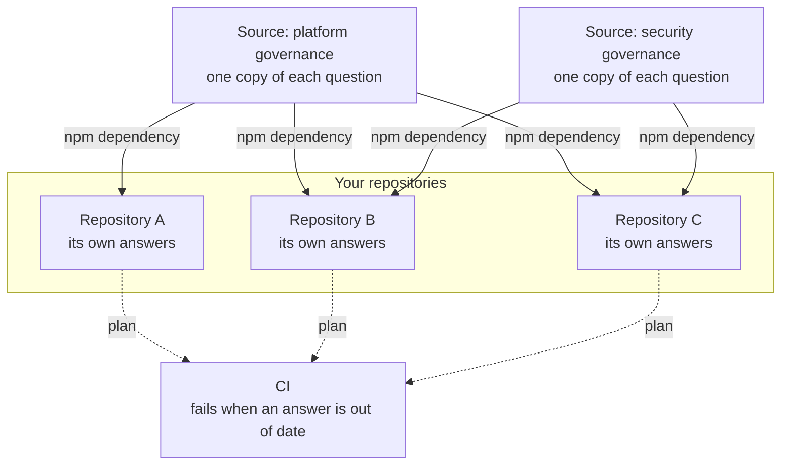
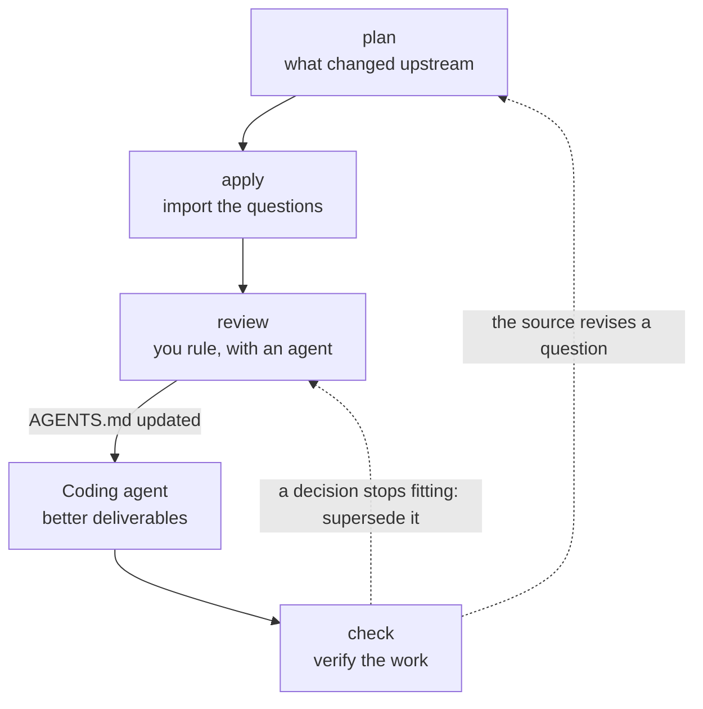
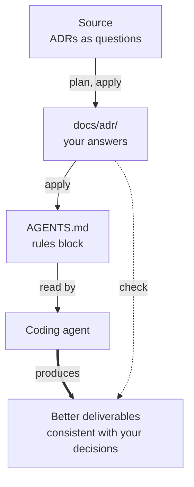

Shared conventions are usually copied from repository to repository, and the
copies drift. ontrack turns them into shared architecture decision records
(ADRs): it keeps one copy of each question, lets every repository answer it
for itself, and tells you when an answer is out of date.



## Write a convention once, as a question

A convention lives in a **source**: a repository of ADRs, each asking one
question (how do we commit, branch, test,
deliver?) and recommending an answer.

- A source is an npm dependency. You install, pin and update it with the tools you already use; there is no registry or server to run.
- The npm alias you install it under is its namespace, so several sources can sit side by side in one repository.
- A source is small: a `package.json` with an `ontrack` key and a directory of ADRs. [trivoallan/governance](https://github.com/trivoallan/governance) is a working example.
- A published JSON Schema lets a source author's editor check the `ontrack` key while they type.

## Each repository answers for itself

ontrack imports questions, not answers. A repository takes the source's
recommendation, adapts it, or rejects it, and records why in its own copy of
the ADR.

- `ontrack apply` copies new ADRs into `docs/adr/<namespace>/`, byte for byte.
- A decision is a few keys in the ADR's frontmatter, its **traits**, next to a status: `proposed`, `accepted` or `rejected`.
- A repository can supersede an imported ADR with one of its own when the shared answer stops fitting.
- ontrack never rewrites an ADR you have decided on.

## Know when an answer is out of date

When a question changes upstream, the repositories that answered the old
version need to rule again. `ontrack plan` says which ones.

- It lists what is new, revised or removed in each source, one line per ADR.
- It modifies no file and makes no network call, so it is safe to run anywhere.
- It exits with `2` when something is pending. A CI job detects an out-of-date repository without parsing any output.
- `ontrack apply --dry-run` prints what would be written before anything is.

Governance is a cycle, not a one-off import. It turns again every time a
source revises a question, and whenever a decision stops fitting the
repository:



## Coding agents follow what you decided

Agents read `AGENTS.md`, not ADRs. ontrack writes the decided traits there,
as a rules block it keeps current.



- The block is regenerated by `ontrack apply` from the ADRs, so the rules an agent reads and the decisions on record cannot disagree.
- Questions still open are listed as "Not yet decided", so an agent knows where there is no rule yet.
- Everything outside the block's markers is yours and is never touched.
- ontrack warns when Claude Code would not read `AGENTS.md` because a `CLAUDE.md` exists without importing it.

## Rule with an agent, decide yourself

Seventeen new ADRs are a long afternoon. `ontrack review` prints a prompt
that has a coding agent prepare each ruling from the evidence in your
repository.

```bash
claude "$(npx ontrack review)"
```

- The agent starts from the source's recommendation, looks for evidence that it does not apply here, and proposes a value for every trait.
- It stops and asks before writing anything. The ruling is yours.
- Naming an accepted ADR reopens it: the agent drafts a new ADR that supersedes it, and the original text stays frozen.
- Once the rulings are made, the agent lists the ones the repository does not follow yet and offers to open a tracking item for each.

## Check that the work matches the decisions

A decision can name the command that verifies it, such as
`npx commitlint --from origin/main`. `ontrack check` runs them all.

- One line per ADR: `pass`, `fail` or `unchecked`. A failure shows the rule, the command and its output.
- It exits with `2` on a failure, for CI and for an agent checking its own work.
- A source can ship a check with its ADR. It only runs once your repository holds the ADR as `accepted`, and `plan` shows the old and new command before `apply` changes it.

## Predictable by design

- **One writer.** `apply` is the only command that writes. It never commits, and it runs every check before the first write, so an error never leaves a half-applied repository.
- **One exit-code scheme.** `0` nothing to do, `2` something pending, `1` error, for every command.
- **Stable output.** The format of each command is a documented contract.
- **Plain files.** Decisions are Markdown under `docs/adr/`, reviewed in pull requests like any other change.

## Get started

```bash
npm i -D @trivoallan/ontrack
npm i -D trivoallan@git+https://github.com/trivoallan/governance.git
npx ontrack plan
```

The [commands reference](commands.md) lists every command, its options and
its exit codes. The [README](https://github.com/trivoallan/ontrack#readme)
covers installation, pinning a version, and the full contract of each
command.
