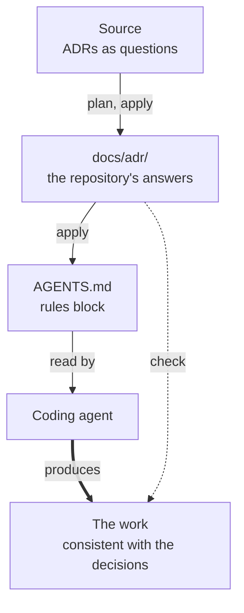
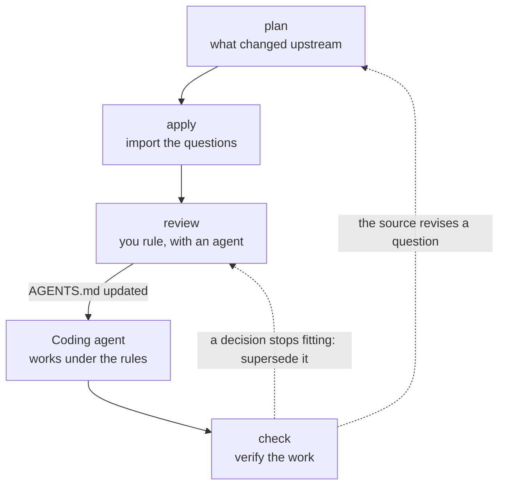
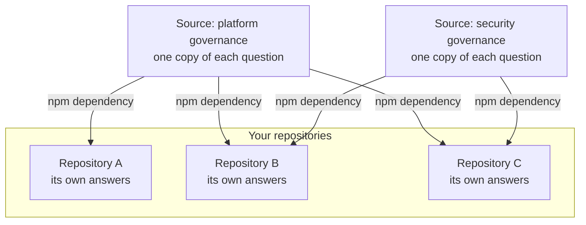

This page explains the model behind ontrack: what you run, what each
repository holds, and what happens over time. For what it is for, see the
[home page](index.md). For each command and its options, see the
[commands reference](commands.md).

## The pieces

ontrack has no server and no database. It works on three kinds of files.

- A **source** is a repository of architecture decision records (ADRs). Each
  ADR asks one question (how do we commit, branch, test, deliver?) and
  recommends an answer. A source is an npm package: a `package.json` with an
  `ontrack` key and a directory of ADRs. You own it, and repositories install
  it as a dependency.
- Each repository holds **its own copy of every ADR**, under `docs/adr/`. The
  copy is where the repository answers. The answer is a status and a few keys
  in the frontmatter, the **traits**. The source ships the traits empty, as
  the question. The repository fills them.
- The **rules block** is a marked section of the repository's `AGENTS.md`.
  ontrack writes the decided traits there, because coding agents read
  `AGENTS.md`, not ADRs.

The rules block is regenerated from the ADRs each time, so the rules an agent
reads and the decisions on record cannot disagree. ontrack copies trait
values and never interprets them. Everything outside the block's markers
belongs to the repository.

## The life of one question

**It arrives as `proposed`.** `ontrack apply` copies a new ADR from the
source into `docs/adr/<namespace>/`, byte for byte. It carries the source's
recommendation, and it is listed in `AGENTS.md` under "Not yet decided", so
an agent knows there is no rule yet.

**A person rules.** The repository follows the recommendation, adapts it, or
rejects it, and writes down why in its copy. The status becomes `accepted` or
`rejected`, and the traits are filled. `rejected` is a full answer: the
question does not apply here, and the ADR says what stands in for it.
`ontrack review` has a coding agent prepare the ruling from the evidence in
the repository. The agent proposes and writes nothing until you agree.

**The source revises the question.** Each ADR carries an integer `revision`.
The source raises it when the question changes. `ontrack plan` compares the
repository's value with the source's and reports the ADR as `revised`.
ontrack never rewrites an ADR a repository has decided on: a person rules
again.

`plan` reads the source as it is installed in the repository and makes no
network call. A revision is therefore reported once the repository has
updated the dependency, not before.

**The answer stops fitting.** A decided ADR is frozen. When a repository's
answer no longer holds, it writes a new ADR of its own that supersedes the
first. The rules block then carries the new decision, and the original text
stays as the record of what was decided before.

## The cycle

Governance is a cycle, not a one-off import. It turns again every time a
source revises a question, and whenever a decision stops fitting the
repository.

`check` closes the loop. A decision can name the command that verifies it,
such as `npx commitlint --from origin/main`, and `ontrack check` runs them
all. ontrack judges nothing itself. A source can ship a check with its ADR.
It only runs once the repository holds that ADR as `accepted`.

## Several sources

A repository can import more than one source: one from the platform team,
another from security. The npm alias a source is installed under is its
**namespace**. Its ADRs live in `docs/adr/<namespace>/`, so sources sit side
by side without colliding.

Because a source is a dependency, each repository installs, pins and updates
it with the tools it already uses.

## What ontrack guarantees

- **One writer.** `apply` is the only command that writes. It never commits,
  and it runs every check before the first write, so an error never leaves a
  half-applied repository.
- **One exit-code scheme.** `0` nothing to do, `2` something pending, `1`
  error, for every command. A CI job needs no output parsing.
- **Stable output.** The format of each command is a documented contract.
- **Plain files.** Decisions are Markdown under `docs/adr/`, reviewed in pull
  requests like any other change. If you stop using ontrack, they remain and
  read the same.

## Next

- [Try it on one repository](tutorial.md), in four commands.
- Look up a command in the [commands reference](commands.md).
