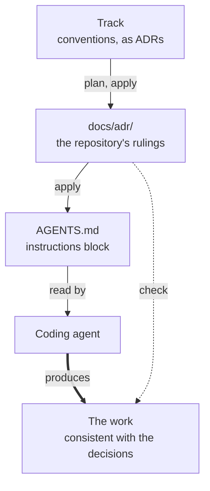
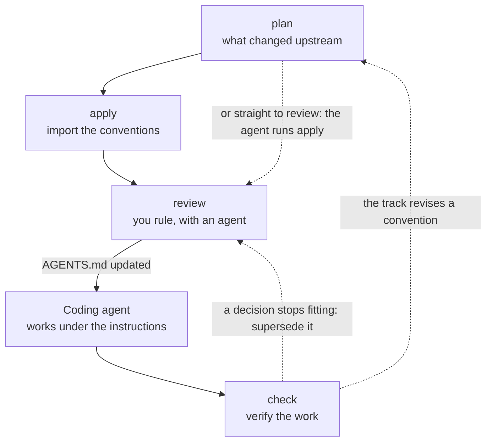
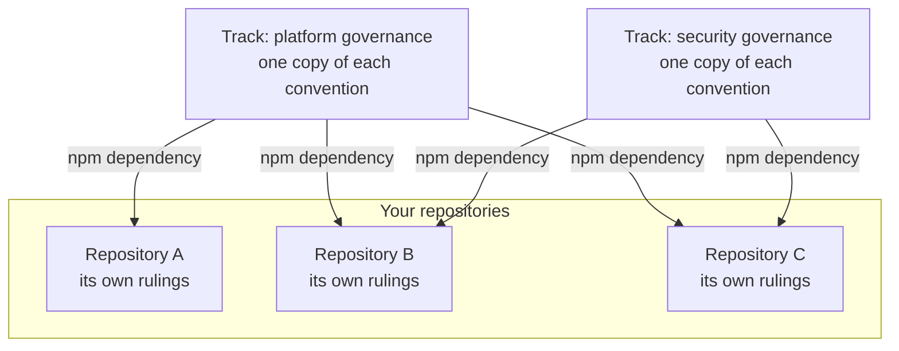

This page explains the model behind ontrack: what you run, what each
repository holds, and what happens over time. For what an ADR, a track or a
ruling is, start with the [concepts](concepts.md). For what it is for, see
[Why ontrack](why-ontrack.md). For each command and its options, see the
[commands reference](commands.md).

## Proposed, not imposed

A shared rule assumes every repository is the same. A repository that
differs has two ways out: override the rule, or stop importing it. Either
way the difference is silent. Nothing records that the repository departs
from the convention, or why. That is how conventions drift.

A convention is proposed, not imposed. It reaches a repository the way a
question would: with a recommendation, and waiting for that repository to
rule. It expects that rulings differ. A repository that departs from the
recommendation says so in its own ADR, with the reason, and the departure is
reviewed in a pull request like any other change. The difference is on
record, next to the convention it rules on.

This has a cost. A person rules on every convention in every repository, and
rules again each time the track revises one. And nothing makes two
repositories rule the same way. When a value must be the same everywhere,
with no exception, a shared configuration does that better, and ontrack does
not replace it.

## The pieces

ontrack has no server and no database. It works on three kinds of files.
[Concepts](concepts.md) defines each of them; this is how they fit together.

- A **track**: an npm package of conventions. Each one is written as an
  architecture decision record (ADR) that states the convention and
  recommends its values. Repositories install the track as a dependency.
- The repository's **own copy of every ADR**, under `docs/adr/`. The
  repository rules there: a status, and the traits it fills.
- The **instructions block** of the repository's `AGENTS.md`. ontrack writes the
  decided traits there, where coding agents read them.

The instructions block is regenerated from the ADRs each time, so the instructions an agent
reads and the decisions on record cannot disagree. ontrack copies trait
values and never interprets them. Everything outside the block's markers
belongs to the repository.

## The life of one convention

**It arrives as `proposed`.** `ontrack apply` copies a new ADR from the
track into `docs/adr/<namespace>/`, byte for byte. It carries the track's
recommendation, and it is listed in `AGENTS.md` under "Not yet decided", so
an agent knows there is no instruction yet. You can run `apply` yourself, or leave
it to `ontrack review`: when a track ships conventions the repository has not
imported, its prompt has the agent run `apply` first.

**A person rules.** The repository follows the recommendation, adapts it, or
rejects it, and writes down why in its copy. The status becomes `accepted` or
`rejected`, and the traits are filled. `rejected` is a full ruling: the
convention does not apply here, and the ADR says what stands in for it.
`ontrack review` has a coding agent prepare the ruling from the evidence in
the repository. The agent proposes and writes nothing until you agree.

**The track revises the convention.** Each ADR carries an integer `revision`.
The track raises it when the convention changes. `ontrack plan` compares the
repository's value with the track's and reports the ADR as `revised`.
ontrack never rewrites an ADR a repository has decided on: a person rules
again. `ontrack review` then asks the agent to prepare that ruling: it keeps
your ruling where the convention did not move, and proposes one where it did.

`plan` reads the track as it is installed in the repository and makes no
network call. A revision is therefore reported once the repository has
updated the dependency, not before.

**The ruling stops fitting.** A decided ADR is frozen. When a repository's
ruling no longer holds, it writes a new ADR of its own that supersedes the
first. The instructions block then carries the new decision, and the original text
stays as the record of what was decided before.

## The decisions no track ships

A repository that adopts ontrack already holds decisions of its own that
nobody wrote down: a test runner chosen over another, a rule a maintainer
repeats in reviews. No track ships them, so `review` never asks about them.
`ontrack suggest` prints a prompt that has a coding agent find them, once:
it reads the history, the reviews and the configuration, drops what an ADR
already covers, and proposes at most five, each with its evidence. Those you
agree to become ADRs of the repository in `docs/adr/local/`, and reach
`AGENTS.md` like any other decision. From then on, a decision is recorded
by the change that takes it.

## The cycle

Governance is a cycle, not a one-off import. It turns again every time a
track revises a convention, and whenever a decision stops fitting the
repository.

A person runs `plan`, then `review`. `apply` is the step that writes: the
agent runs it from the prompt, to import the conventions and again after each
ruling. Run it yourself where there is no agent, in CI for instance.

`check` closes the loop. A decision can name the command that verifies it,
such as `npx commitlint --from origin/main`, and `ontrack check` runs them
all. ontrack judges nothing itself. A track can ship a check with its ADR.
It only runs once the repository holds that ADR as `accepted`.

## Several tracks

A repository can import more than one track: one from the platform team,
another from security. The npm alias a track is installed under is its
**namespace**. Its ADRs live in `docs/adr/<namespace>/`, so tracks sit side
by side without colliding. The ADRs a repository writes for itself live the
same way, in `docs/adr/local/`: `local` is their namespace, and no track
can be installed under that alias.

Because a track is a dependency, each repository installs, pins and updates
it with the tools it already uses.

## What ontrack guarantees

- **One writer.** `apply` is the only command that writes. It never commits,
  and it runs every check before the first write, so an error never leaves a
  half-applied repository.
- **One exit-code scheme.** `0` nothing to do, `2` something pending, `1`
  error, for every command. A CI job needs no output parsing.
- **Stable output.** The format of each command is a documented contract.
- **Plain files.** Decisions are Markdown under `docs/adr/`, reviewed in pull
  requests like any other change. If you stop using ontrack, they remain and
  read the same.

## Next

- [Try it on one repository](tutorial.mdx), in four commands.
- Look up a command in the [commands reference](commands.md).
