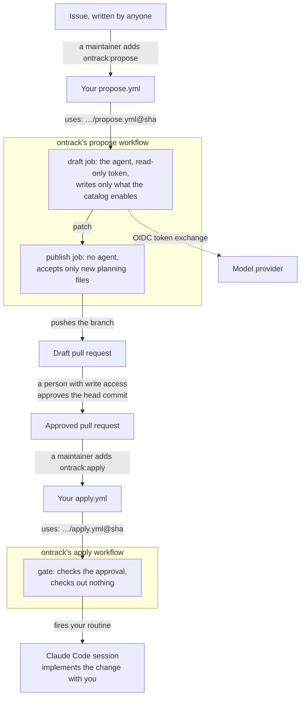

The `ontrack:propose` and `ontrack:apply` labels run two workflows that live
in ontrack. Your repository calls them with a few lines of YAML, pinned to a
commit. This page explains why they are not copied into each repository, and
what that choice costs. [ADR-0004](adr/local/ADR-0004-other-repositories-call-the-propose-and-apply-workflows.md)
records the decision.

## Most of a workflow is its security posture

`propose` turns the text of an issue, which anyone can write, into a branch
of your repository. The text is untrusted; what keeps it from reaching more
than planning files is how the workflow is cut:

- the agent runs in a job whose token can only read, and stores no key: it
  exchanges the job's identity token for a short-lived token of the model
  provider;
- the agent may only write what the frameworks you enabled write;
- the job that pushes runs no agent, and accepts only new planning files.

`apply` does even less with the pull request: it checks out nothing, reads
the reviews, and starts a session only when a person with write access
approved the head commit.

Copied into each repository, that posture would drift copy by copy: a fix
made in one would not reach the others. Called, it is maintained in one
place, and a fix reaches every caller as a Dependabot pull request.

## A caller chooses names, not rules

What the agent may write is a closed catalog in ontrack. A caller enables
entries by name, `openspec` or `adr`. It never passes a path, a pattern or a
tool rule. The filter is the only barrier between an issue and the branch:
a filter supplied by each caller would be reviewed by nobody. A new
framework joins the catalog through a pull request to ontrack, where it is
reviewed once for everyone.

## A pin, not a branch

A caller names a commit SHA, not `main` or a tag: a tag can be moved, and a
branch changes under you. Dependabot proposes the SHA of each new release,
with its tag in the comment, so the pin moves only through a pull request you
merge.

## What it costs

- A caller bumps the pin at each release of ontrack, including releases that
  only change the command line.
- A change to the catalog or to the inputs that breaks callers is a major
  version of ontrack.
- A caller grants the union of the permissions of ontrack's jobs. The
  separation that makes this safe is visible in ontrack, not in your
  repository.
- Each caller needs its own federation rule with the model provider: the
  identity the provider sees is your repository, not ontrack.

## The other ways

- **Copy the workflows.** Each repository can adapt them, and each copy is a
  security posture of its own to maintain.
- **A composite action.** It runs inside one job, and the separation between
  the job that runs the agent and the job that writes needs two.
- **A dedicated repository.** Its own versions, but a second dependency for
  every caller. It becomes worth it the day a repository wants the workflows
  without ontrack.

## Related

- [Draft a change from a labelled issue](draft-a-change-from-an-issue.md)
  sets them up.
- [Propose and apply workflows](propose-and-apply-workflows.md) lists their
  inputs, and what a calling repository holds.
